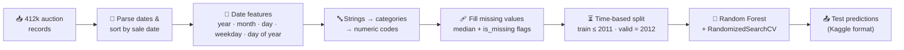
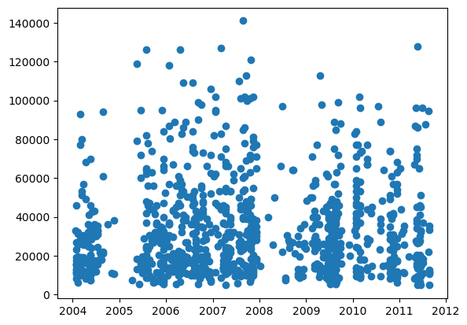
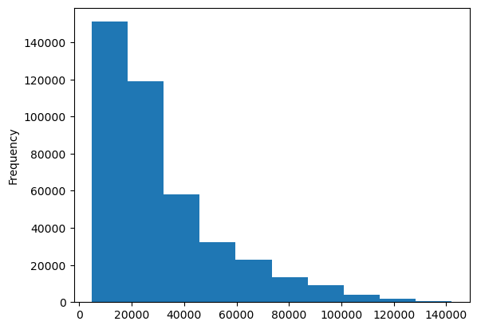
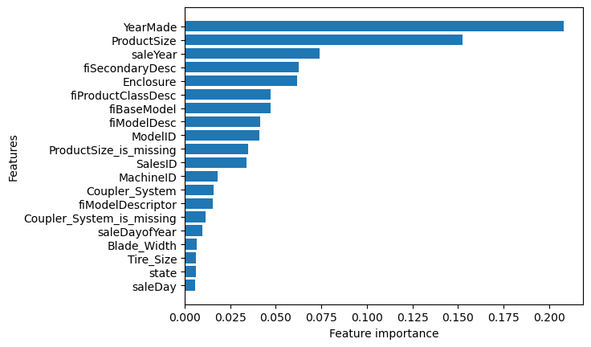

<div align="center">

# 🚜 Bulldozer Price Prediction

**Predicting the auction sale price of heavy machinery from its characteristics and sale date: a time-series regression problem on 400,000+ real auction records.**


**🎯 Validation RMSLE 0.245 · 📈 Validation R² 0.88 · 💵 Mean absolute error ≈ $5,950**

</div>

---

## 📌 Problem

> How well can we predict the future sale price of a bulldozer, given its characteristics and previous examples of how much similar bulldozers sold for?

The data comes from the Kaggle **Blue Book for Bulldozers** competition: **412,698 auction sales** from **1989 to 2012**, each described by **52 columns** (model, size, year made, machine hours, enclosure, hydraulics, location, …). Many columns have heavy missing data, which makes this a realistic, messy dataset.

> Built as part of the Zero to Mastery *Machine Learning & Data Science Bootcamp*.

## 🔁 Workflow



## 🔍 Data exploration

<div align="center">

| Sale date vs. sale price | Sale price distribution |
|---|---|
|  |  |

</div>

- Sale prices are **right-skewed**: most bulldozers sell for under $40k, with a long tail of expensive machines.
- Because this is time-series data, the dataset is **sorted by sale date** and validated on the **most recent year**, so the model is always tested on the future, never the past.

## 🛠️ Feature engineering & preprocessing

| Step | What was done | Why |
|---|---|---|
| 📅 Date enrichment | `saledate` → `saleYear`, `saleMonth`, `saleDay`, `saleDayOfWeek`, `saleDayOfYear` | Lets the model learn seasonal and yearly price trends |
| 🔤 Categorical encoding | Text columns → pandas categories → integer codes | Random forests need numeric input |
| 🔢 Numeric missing values | Filled with the **median** (robust to outliers) | Avoids distortion from extreme values |
| 🚩 Missing-value flags | Added a binary `<column>_is_missing` feature for every column with gaps | "Missing" can itself be informative |
| 🔁 Reusable pipeline | `preprocess_data()` function applied identically to train and test data | Guarantees consistent features at prediction time |

Result: **102 numeric features**, no missing values.

## 🌲 Modelling & results

The competition metric is **RMSLE** (root mean squared log error), which penalises relative errors equally for cheap and expensive machines.

| Model | Training data | Valid MAE | Valid RMSLE | Valid R² |
|---|---|---|---|---|
| Random Forest (baseline, `max_samples=10,000`) | 10k samples per tree | $7,177 | 0.294 | 0.832 |
| Random Forest (`RandomizedSearchCV`, quick search) | 10k samples per tree | $10,491 | 0.418 | 0.680 |
| **Random Forest (best hyperparameters)** | **All 401,125 training rows** | **$5,951** | **0.245** | **0.882** |

**Best hyperparameters** (found after 100 iterations of `RandomizedSearchCV`): `n_estimators=40`, `min_samples_split=14`, `min_samples_leaf=1`, `max_features=0.5`.

💡 Limiting `max_samples` to 10,000 cut training time from **~3.5 minutes to ~6 seconds**, which made fast experimentation possible before training the final model on all of the data.

## 💡 Feature importance

<div align="center">

</div>

The model's predictions depend most on:
1. 🏭 **`YearMade`**: newer machines sell for more
2. 📏 **`ProductSize`**: bigger machines are worth more
3. 📅 **`saleYear`**: market trends over time
4. 🏷️ **Model descriptors** (`fiSecondaryDesc`, `fiBaseModel`, `fiModelDesc`, `ModelID`)
5. 🛡️ **`Enclosure`**: cab type (e.g. EROPS with A/C) adds value

## 📁 Repository structure

```
bulldozer-price-prediction/
├── end-to-end-bulldozer-price-regression.ipynb   # Full analysis, preprocessing and modelling
├── assets/                                       # Figures used in this README
├── .gitignore                                    # Excludes data/ and env/
└── README.md
```

## 🚀 Running it

1. Download the data from the [Kaggle Blue Book for Bulldozers competition](https://www.kaggle.com/c/bluebook-for-bulldozers/data).
2. Extract it to `data/bluebook-for-bulldozers/`, so that the folder contains `TrainAndValid.csv` and `Test.csv`.
3. Install the dependencies and open the notebook:

```bash
pip install pandas numpy scikit-learn matplotlib jupyter
jupyter notebook end-to-end-bulldozer-price-regression.ipynb
```

> ⏱️ Training the final model on all 400k rows takes about a minute on a multi-core CPU.

---

<div align="center">
<sub>Made by <a href="https://github.com/zeyad4231">Zeyad Rashwan</a>.</sub>
</div>
